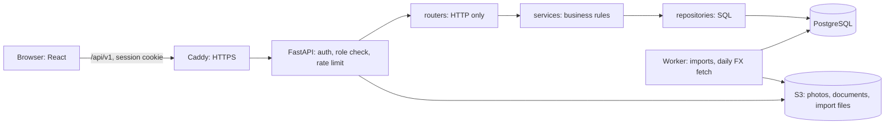

# Architecture & Plan

> Summary. The detail is in the design pack: [database](design/03-DATABASE.md), [backend](design/04-BACKEND.md), [UI](design/05-UI.md), [deployment](design/06-DEPLOYMENT.md). Where they differ, the design docs win.

## Stack (and why)
| Layer | Choice | Reasoning |
|------|--------|-----------|
| API | **Python 3.12, FastAPI** + Pydantic v2 | Typed validation, auto OpenAPI docs, little boilerplate |
| ORM / migrations | **SQLAlchemy 2.0** (asyncio, `AsyncSession`) + **Alembic** | Mature, explicit, portable; async endpoints don't hold a thread while waiting on the database |
| DB | **PostgreSQL** everywhere: local development and tests (Docker), CI and the server | Same engine in development, tests and production |
| UI | **React + Vite + TypeScript**, **shadcn/ui** (Tailwind + Radix), TanStack Table + Query, Recharts | One light styling system; we own the component code |
| Tooling | uv, ruff, pytest; Vitest + Testing Library; GitHub Actions | Fast, standard |
| Containers | **Docker** multi-stage image (builds the UI, serves it from FastAPI); the same image runs the web app and the worker; `docker compose` for local dev | One-command setup that matches production |
| Deploy | One AWS EC2 server in Mumbai with Docker Compose (Caddy, web app, worker, Postgres); S3 for files and backups; CloudWatch logs | See [design/06-DEPLOYMENT.md](design/06-DEPLOYMENT.md) |

## How a request flows


## Data model (summary)
```
users             email UNIQUE, name, password_hash, role (hr_admin | hr_viewer), active,
                  created_at, created_by, session_version
employees         employee_code UNIQUE, names, email UNIQUE, gender (optional, never listed/exported),
                  job_title, job_level 1–6, department_id, country_code, city,
                  employment_type, fte, hire_date, status (active | left), left_on, photo_key,
                  current_salary NUMERIC(14,2), current_currency, current_salary_usd,   -- denormalized
                  salary_effective_date, version, updated_by, timestamps
salary_records    employee_id, amount NUMERIC(14,2), currency, effective_date, reason, note,
                  import_job_id, created_by, created_at          -- append-only, never edited
employee_documents employee_id, kind (photo | document), file metadata, storage_key, uploaded_by
fx_rates          (currency, rate_date) PK, usd_per_unit, source -- one row per currency per day
import_jobs / import_rows   job status, mode, counters / staged rows with errors
countries (6), departments
```
**Trade-off:** the current salary (local and USD) is stored on the employee, so list sorting, filtering and Insights are single-table queries instead of "latest record per employee" subqueries. It is updated in the same transaction as each new salary record (a daily job promotes future-dated ones), and a test checks they stay consistent.

**FX:** daily ECB reference rates (via Frankfurter) are stored by date; after each fetch one bulk update refreshes `current_salary_usd`. If a fetch fails, the last good rates stay in use. Cross-country figures are in USD with the rate date shown; within one country, local currency.

## API (v1, all under `/api/v1`)
```
POST /auth/login · POST /auth/logout · GET /auth/me
GET  /health · GET /meta · GET /fx-rates
GET  /employees            ?q&country&department_id&job_title&level&status&employment_type&sort&order&page&page_size
POST /employees · GET/PATCH /employees/{id} · POST /employees/{id}/mark-left · /reactivate
GET/POST /employees/{id}/salaries
GET  /salary-changes/recent?limit · GET /salary-changes?page&page_size
PUT/DELETE /employees/{id}/photo · GET/POST /employees/{id}/documents · …/{doc_id}/download · DELETE …/{doc_id}
GET  /employees/export.csv  same filters as the list
GET  /insights/summary · /by-country · /by-department · /by-role · /distribution · /outliers
GET  /imports/template.xlsx · POST /imports · GET /imports · GET /imports/{id} · /rows · /errors.csv
POST /imports/{id}/commit · /cancel
```
Every write needs the HR Admin role (`403` for HR Viewers). Full table with rate limits: [design/04-BACKEND.md §2](design/04-BACKEND.md).

## Backend layout (layered, so it can be tested)
```
backend/app/
  main.py          app factory, routers, serving the SPA
  models.py        SQLAlchemy models
  schemas.py       Pydantic DTOs
  core/            config, db, auth, cache, rate limit, storage, errors
  repositories/    queries only
  services/        business rules (salary changes, insights maths, import validation, FX)
  routers/         HTTP only
  worker/          job runner (`python -m app.worker`)
backend/scripts/seed.py
backend/tests/     unit (services) + API (TestClient, a fresh Postgres database per test)
```

## Design principles
**Simple, lightweight, ready to scale.** One small service plus a worker, few dependencies, no infrastructure we don't need today. Each optimization sits behind a small interface, so moving to more instances later is a config change, not a rewrite.

## Optimizations
| Concern | v1 implementation (lightweight) | How it scales later |
|--------|----------------------------------|---------------------|
| **Indexing** | Indexes match the real query patterns: `(status, country_code, job_title)`, `department_id`, `(last_name, first_name)`, `current_salary_usd`, `lower(job_title)`, unique `employee_code` / `email` (stored lower-cased), `(employee_id, effective_date)` and `(created_at, id)` on salary records. Verified with `EXPLAIN ANALYZE` on Postgres with 10,000 employees | Postgres trigram index for fuzzy name search if needed |
| **Pagination** | Every list endpoint is paginated (`page`, `page_size`, default 20, max 100), with sorting and filtering in SQL and `id` as tiebreaker; the response includes `total` | Keyset (cursor) pagination for very deep pages, behind the same envelope |
| **Caching** | Insights and `/meta` use an in-process cache keyed by a **data version** that every write bumps in the same transaction, so numbers are never stale after an edit. ETag/304 on those reads; TanStack Query caches on the client | The cache sits behind a `Cache` interface → Redis via `CACHE_URL` with more than one instance |
| **Rate limiting** | `slowapi` per signed-in user (login per IP, 5/min): reads 120/min, writes 30/min, uploads 10/min, imports and CSV export 5/min; `429` with `Retry-After` | Redis storage via `RATE_LIMIT_STORAGE_URL` for a shared limit |
| **Long-running work** | Imports and the daily FX fetch run in the worker container; the Postgres `import_jobs` table is the queue (`FOR UPDATE SKIP LOCKED`); the UI polls progress | More worker containers or machines; a broker only if task volume demands it |
| **Payload size** | GZip middleware; list responses return only the columns the table needs | — |
| **Browser caching** | `/assets/*` is cached for a year (`immutable`) because Vite hashes every name there; `index.html` is `no-cache` so a release is picked up at once. Never put files in `frontend/public/assets/`: Vite copies them unhashed into `/assets/`, and an edited file would stay cached for a year | A CDN in front honours the same headers |
| **Aggregation** | count/sum/min/max done in SQL; medians and percentiles per group in Python over sorted values | Postgres `percentile_cont` |
| **Frontend** | Debounced search (300 ms), server-side pagination, lazy-loaded routes, small bundle | — |
| **Seed** | Bulk inserts in batches of 1,000; deterministic RNG; fixed FX snapshot | — |

**Statelessness:** the session lives in a signed cookie and jobs live in the database, so the web app can run as N replicas behind a load balancer. The only per-process state (cache, rate-limit counters) is exactly what moves to Redis.

**Deliberately not added:** Redis, message brokers, microservices or Kubernetes. They are unnecessary at 10k employees and a small HR team, and they make the app harder to run. The interfaces above keep the path open.

## Delivery plan (each phase is ≥1 commit)
1. Requirements, decisions and design docs ← *we are here*
2. Backend scaffold: FastAPI app, config, DB, health check, pytest, ruff
3. Models, migrations, deterministic seed script with a fixed FX snapshot (+ tests)
4. Auth: users, login/logout, sessions, HR Admin / HR Viewer checks (+ tests)
5. Employee CRUD, mark as left, search/filter/sort/pagination API (+ tests)
6. Salary history API, current-salary promotion for future dates (+ tests)
7. Insights API + data-version cache (+ tests for the stats maths and cache)
8. Rate limiting, GZip, ETag (+ tests for 429/304)
9. Daily FX fetch in the worker (+ tests with a fake HTTP client)
10. Photos and documents with local/S3 storage (+ tests)
11. Bulk import: job tables, worker, validation, preview, apply, error report; CSV export (+ tests)
12. Frontend scaffold, sign-in, sidebar, Home
13. People directory with filters, employee page, change salary, documents
14. Insights and Imports screens
15. Docker, CI, AWS EC2 deployment (Docker Compose, S3, CloudWatch, SSM, backups)
16. README, AI-usage notes, demo video
