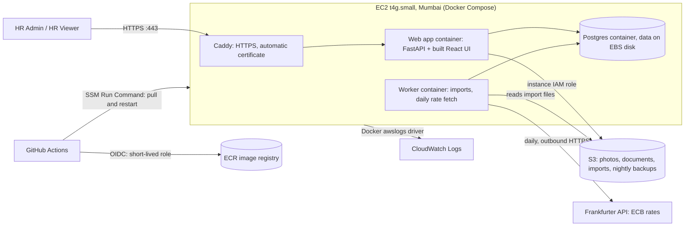

# 06 · Deployment and secrets

**One AWS EC2 server in Mumbai (ap-south-1), running the app with Docker Compose.** It is also the public demo link for reviewers. No load balancer, no container cluster, no managed database: the brief asks for good judgment, not the most complex system, and one server comfortably handles 10,000 employees (and 50,000).

## 1. Environments
| Environment | Where | Database | Purpose |
|---|---|---|---|
| Local | `docker compose up` on a laptop | Postgres container | Development |
| CI | GitHub Actions | SQLite (fast unit tests) + Postgres service container | Every push and pull request |
| Production / demo | One EC2 server, `docker compose` | Postgres container on the server's disk | The deployed app |

Local and production use **the same Docker image and almost the same Compose file**; only environment variables and the HTTPS proxy differ.

## 2. Why one server is enough
- **Data size:** 10,000 employees with a few salary entries each is about 50,000 rows; even 50,000 employees is roughly 250,000 rows, tens of megabytes. Postgres with our indexes answers list and Insights queries in milliseconds.
- **Load:** a small HR team; targets assume about 5 people working at once.
- **Background work** (imports, the daily rate fetch) runs in a separate worker container on the same machine.
- **Cost and simplicity:** one machine to understand, deploy, back up and explain.

**What we accept:** if the server goes down, the app is down until it restarts (Docker restarts containers automatically; the server can be restored from backups). For an HR tool used in office hours, that's a reasonable trade.

## 3. Region: Mumbai (ap-south-1)
| Option | Verdict |
|---|---|
| **Mumbai (ap-south-1)** | **Chosen**: closest AWS region to India, which has the most employees |
| Singapore (ap-southeast-1) | Close to India, Singapore and Australia |
| US East (N. Virginia) | Closest to the US, Canada and Brazil; far from India |

The app, database and file storage share the region: no cross-region delay or transfer cost. Users in the Americas get more network delay per request (server-side targets unchanged). Nothing in the code depends on the region.
**Data protection laws** are out of scope for this assessment; the app keeps personal data to a minimum.

## 4. The server

- **Instance:** `t4g.small` (Graviton/ARM, 2 vCPU, 2 GB RAM), 20 GB encrypted EBS disk, Ubuntu LTS (arm64) with automatic security updates, an **Elastic IP** so the address never changes.
- **Containers (Docker Compose):**
  - **Caddy** serves HTTPS and gets a free Let's Encrypt certificate automatically. It needs a hostname: a domain if you have one, otherwise a free `<elastic-ip>.sslip.io` name that points to the server.
  - **Web app**: the one image we build (FastAPI serving the API and the built React UI).
  - **Worker**: the same image started with `python -m app.worker`; processes imports from the Postgres job table and runs the daily rate fetch. No message broker.
  - **Postgres 16** with its data on the server's disk; not reachable from the internet.
  - Every container has `restart: unless-stopped` and a health check.
- **Firewall (security group):** only ports 80 and 443 are open. **No SSH port**: admin access uses AWS Systems Manager (Session Manager), so there are no SSH keys to lose.
- **Files:** photos, documents and import uploads go to a private, encrypted **S3** bucket (public access blocked; downloads through short-lived signed links). The server reaches S3 through its **IAM instance role**, so there are no access keys.
- **Logs:** containers send structured logs to **CloudWatch Logs** through Docker's `awslogs` driver (Q38). No alerting or tracing.
- **Rough cost:** about $18–23 a month (`t4g.small` ~$13, disk ~$2, Elastic IP ~$4, S3 and logs pennies). New AWS accounts get sign-up credits. These are estimates; check AWS pricing.

## 5. Backups and recovery
- **Nightly database dump** (`pg_dump`, compressed) uploaded to S3 by a small cron container; S3 keeps 14 days, then deletes old dumps automatically.
- **Weekly EBS snapshot** of the whole disk (Amazon Data Lifecycle Manager), 4 kept.
- **Restore:** start a fresh server from the setup script, restore the latest dump; target about 2 hours. Documented and tried once before the demo.

## 6. Setup, deploys and turning the server off (CloudFormation, no Terraform)
Everything lives in the Claude skill **`.claude/skills/aws-deploy/`** (git-ignored like all skills until the author publishes them). From the repo root:

| Command | What it does |
|---|---|
| `scripts/deploy.sh` | Creates everything on the first run, releases the current commit on every later run; a second run changes nothing |
| `scripts/deploy.sh --plan` | Shows the CloudFormation change set without applying it |
| `scripts/server.sh start [hours]` / `stop` / `status` | Turns the demo server on and off to save money (below) |
| `scripts/logins.sh`, `scripts/destroy.sh` | Author only, in their own terminal (they refuse when output is captured) |

- **Infrastructure** is one CloudFormation template, `infra/stack.yml`: a small VPC with one public subnet, the security group (80/443 only), the `t4g.small` server with its Elastic IP and IAM instance role, the S3 bucket (14-day expiry on `backups/`), the ECR repository, the CloudWatch log group, the weekly snapshot policy and the **$10 monthly budget alert**. CloudFormation needs only the AWS CLI, keeps no local state file and rolls back a failed change by itself. The Ubuntu image id is fixed when the stack is first created, so later runs never replace the server.
- **What `deploy.sh` does:** (1) checks the tools and the AWS identity (refuses root keys); (2) applies the stack; (3) creates the SSM secrets with random values **only if they don't exist yet**, so a re-run never changes the database password; (4) builds the image for `linux/arm64` and pushes it to ECR tagged with the git commit (clean tree required); (5) sets the `acme` A record for `docrelay.in` through the **GoDaddy API** (token read from the git-ignored `.env`) and waits until it resolves; (6) copies `server/` to the server through S3 and runs `remote-update.sh` with SSM Run Command: it writes the root-only `.env` straight from SSM, pulls the image, runs `alembic upgrade head`, swaps the containers and goes back to the previous image if the app is unhealthy; (7) checks `https://acme.docrelay.in/api/v1/health`; (8) schedules the auto-stop.
- **Turning the server off:** `server.sh stop` backs up the database and files to S3, then stops the server. `server.sh start` starts it and schedules it to back up and stop itself after 4 hours (configurable; running `start` again resets the timer). The Elastic IP stays attached, so the address and DNS never change. Stopped, the setup costs about $6 a month (address and disk); running adds about 2 cents an hour. The $10 budget is an email alert (80% actual, 100% forecast), not a cap.
- **Credentials:** the AWS keys stay in the author's `~/.aws` profile (an IAM user, never root); keys exported in the shell are ignored so the profile can't be overridden. The server uses only its instance role. Secrets travel only through pipes: never in command arguments, SSM command text, CloudFormation parameters, the image or logs. The skill's rules forbid Claude from reading `.env`, AWS credentials or secret values.
- **Checks:** `shellcheck`, `cfn-lint` and 39 `bats` tests with stubbed `aws`/`curl`/`dig` (no network), including tests that the GoDaddy token and generated secrets never appear in command arguments. The AWS CLI can't read `--cli-input-json` from a pipe, so each new secret goes through an owner-only temp file deleted right after the call.
- **CI** (`.github/workflows/ci.yml`, every push and pull request): backend ruff and pytest; frontend lint, type check, Vitest and build; the deploy scripts' shellcheck, cfn-lint and bats; a `gitleaks` scan of the whole history; and the real image run against a Postgres service (migrations, seeding twice, health, UI, login, and a worker that must stay up), because the unit tests use SQLite.
- **Deploy button** (`.github/workflows/deploy.yml`, Actions > Deploy > Run workflow, `main` only): runs every CI check, then `deploy.sh --release` on an ARM runner in the `production` environment. It signs in through a GitHub OIDC role (no AWS keys in GitHub) that can only release: describe the stack, push to the one ECR repository, write `deploy/` in the bucket, start the server and send SSM commands to it. It cannot change the stack, IAM or the stored secrets; those changes run from the author's laptop with `deploy.sh`. It is still root on the server (it runs shell commands there and writes the scripts the server runs as root), so it can read the server's `.env`; only jobs in the `production` environment can use it, and that environment should have required reviewers. A stopped server is started first; the auto-stop hours are an input (default 4).

## 7. Secrets management
**Rule: no secret is ever in the repo, the Docker image or the logs.**

| Secret | Local | GitHub Actions | Server |
|---|---|---|---|
| `POSTGRES_PASSWORD` / `DATABASE_URL` | `.env` (git-ignored) | Not needed (CI uses a throwaway DB) | **SSM Parameter Store (SecureString)**, written to the server's `.env` (readable only by root) at deploy time |
| `SECRET_KEY` (signs session cookies) | `.env` | — | SSM Parameter Store |
| `DEMO_ADMIN_PASSWORD`, `DEMO_VIEWER_PASSWORD` (used once by the seed, stored as hashes in `users`) | `.env` | — | SSM Parameter Store |
| S3 and CloudWatch access | Local folder / console logs | — | **IAM instance role**: no keys |
| AWS deploy access | Author's `acme` profile (IAM user) | **OIDC** role trusted only for this repo's `production` environment; release-only (one ECR repository, `deploy/` in the bucket, start and SSM commands on one instance) | — |

Also: `.env.example` with fake values is committed; the app refuses to start if a required secret is missing; `gitleaks` in CI fails on any commit containing keys (the fixed test key is listed in `.gitleaksignore`); logs never include secrets, salaries or personal data.

## 8. How it would scale (documented, not built)
The app keeps no session state on the server, so growth is a series of small steps:
1. **Bigger server** (`t3.medium` / `t3.large`): covers far more than 50,000 employees.
2. **Database off the box** to RDS PostgreSQL: managed backups, failover.
3. **Two or more app servers behind a load balancer** (an Auto Scaling group), with the cache and rate limits moved to Redis (a config change) and the worker container moved to its own machine.
4. **Frontend on S3 + CloudFront** if users spread worldwide: CloudFront serves the UI from S3 and routes `/api/*` to the servers, so the app stays on one domain (no CORS or cross-site cookie problems).

**Considered and rejected for now:** frontend on S3 + CloudFront with the API on EC2. It would mean two origins (CORS, cross-site login cookies that browsers increasingly block) or extra CloudFront routing and cache invalidation on every deploy, for a tiny gain: the UI is about 1 MB, cached by the browser, and used by a small HR team.

## 9. Demo access
The app is public, so it's behind sign-in with **two demo logins** (HR Admin and HR Viewer). The credentials go to reviewers in the submission email and the README; passwords are never in the repo. Login attempts are rate-limited.
